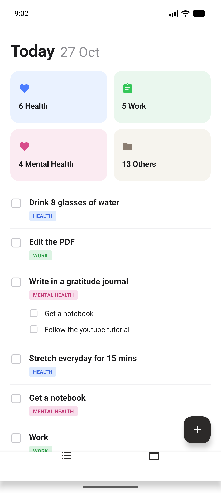
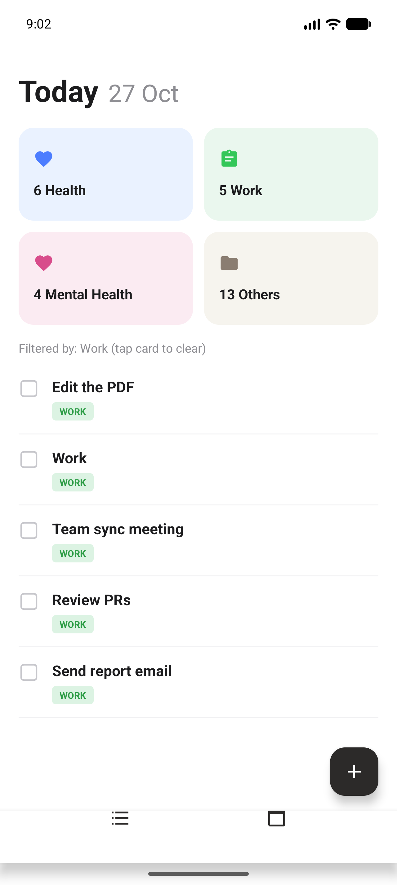
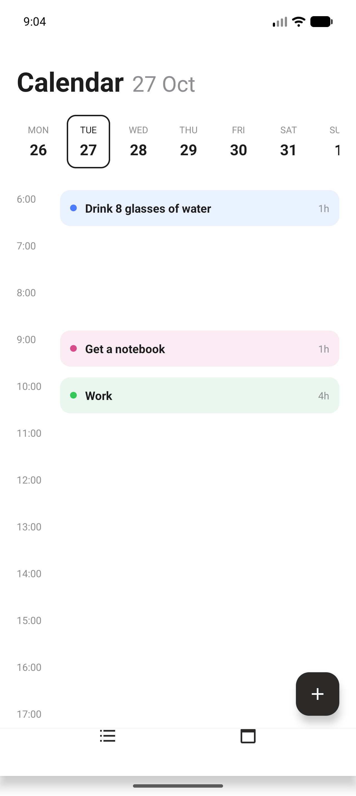
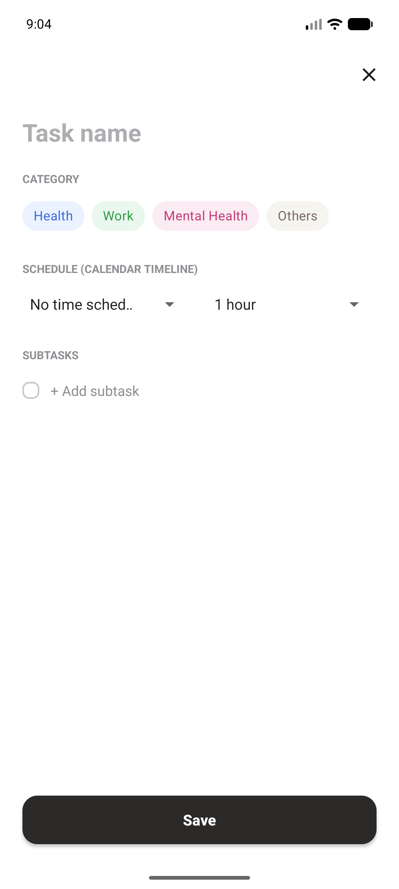
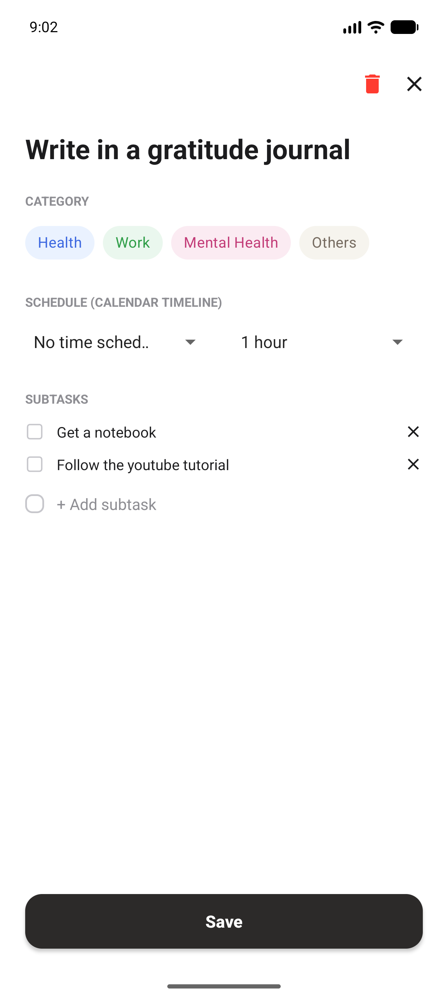
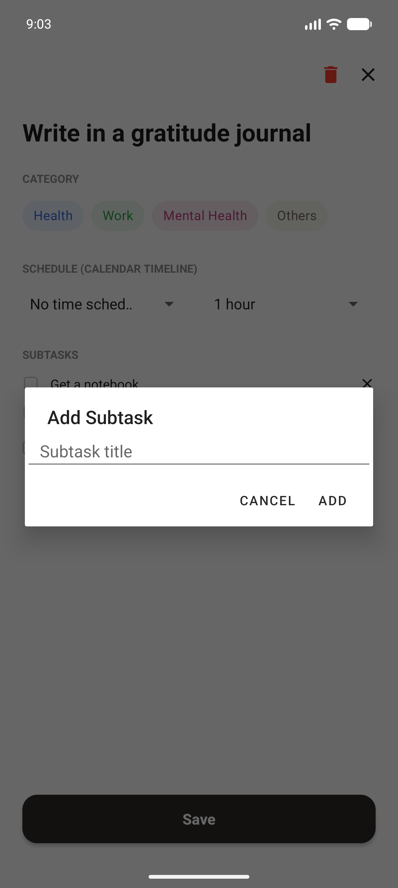
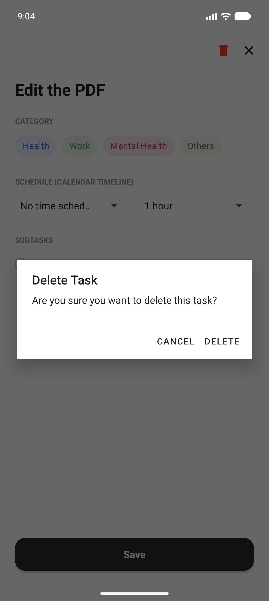
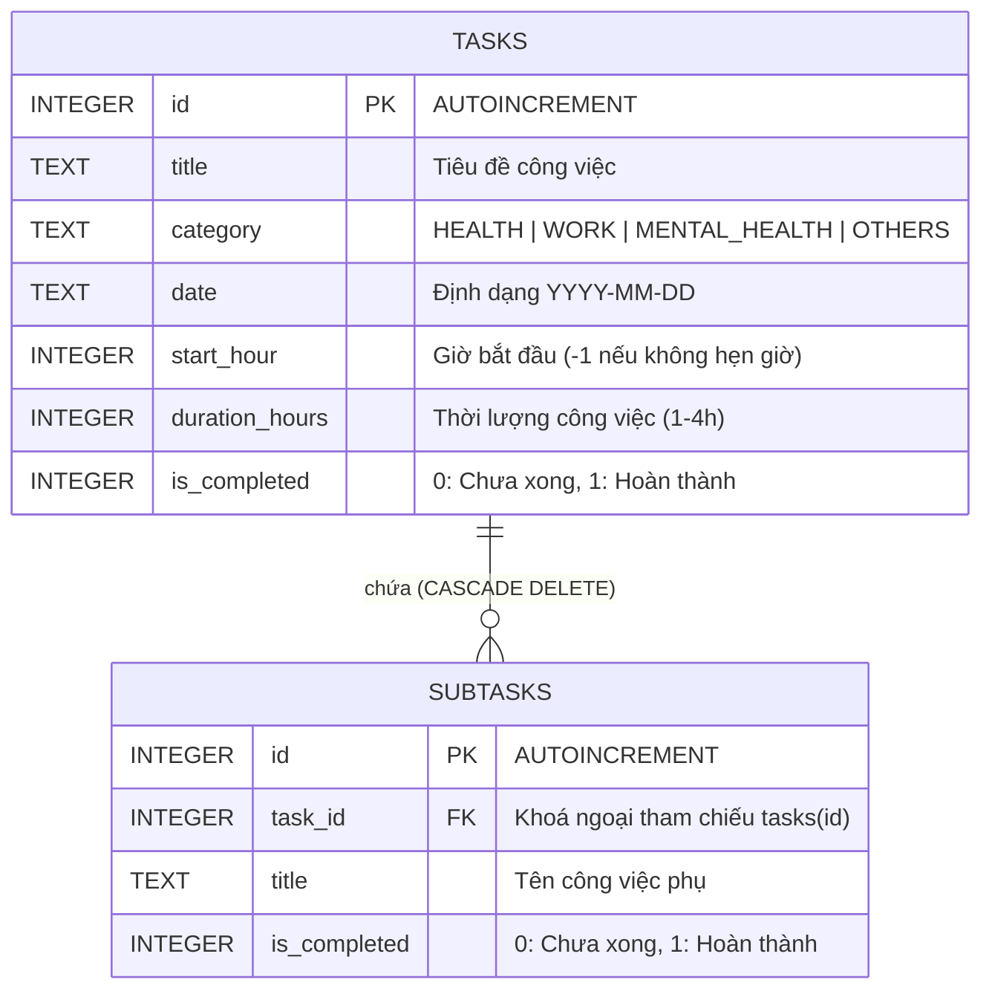

# 📱 To-Do App - Ứng Dụng Quản Lý Công Việc & Lịch Trình Cá Nhân

Ứng dụng quản lý công việc (To-Do & Schedule Planner) được xây dựng trên nền tảng **Android (Java)**, mang phong cách giao diện hiện đại **Material Design**, tối giản và trực quan. Ứng dụng hỗ trợ người dùng phân loại công việc theo danh mục, chia nhỏ việc cần làm với các đầu việc con (subtasks), theo dõi tiến độ và lập thời gian biểu chi tiết theo dạng dòng thời gian (Timeline).

---

## 📑 Mục lục
- [Tính năng nổi bật](#-tính-năng-nổi-bật)
- [Giao diện & Ảnh chụp màn hình](#-giao-diện--ảnh-chụp-màn-hình)
- [Kiến trúc & Công nghệ sử dụng](#-kiến-trúc--công-nghệ-sử-dụng)
- [Cấu trúc mã nguồn](#-cấu-trúc-mã-nguồn)
- [Thiết kế Cơ sở dữ liệu](#-thiết-kế-cơ-sở-dữ-liệu)
- [Hướng dẫn cài đặt & Khởi chạy](#-hướng-dẫn-cài-đặt--khởi-chạy)

---

## ✨ Tính năng nổi bật

### 1. 📋 Quản lý công việc hàng ngày (Today View)
- **Thống kê theo danh mục trực quan**: 4 thẻ màu phân loại tương ứng với các nhóm công việc:
  - 🩺 **Health**: Sức khỏe, tập luyện, thói quen sống lành mạnh.
  - 💼 **Work**: Học tập, công việc, dự án.
  - 🧘 **Mental Health**: Thư giãn, thiền, đọc sách, nhật ký.
  - 📁 **Others**: Các công việc sinh hoạt cá nhân khác.
- **Lọc nhanh công việc**: Chạm vào bất kỳ thẻ danh mục nào để lọc ngay danh sách công việc thuộc nhóm đó; chạm lại để huỷ lọc.
- **Đánh dấu hoàn thành tức thì**: Tích chọn checkbox để chuyển trạng thái công việc kèm hiệu ứng gạch ngang tiêu đề.
- **Tiến độ công việc con (Subtasks progress)**: Thanh hiển thị tỷ lệ hoàn thành các đầu việc con trực tiếp trên từng thẻ công việc.
- **Xoá nhanh bằng cử chỉ vuốt (Swipe to Delete)**: Vuốt sang trái để xoá công việc với hiệu ứng nền đỏ và nhãn `Delete`.

### 2. 📅 Lịch tuần & Dòng thời gian biểu (Calendar & Timeline View)
- **Thanh chọn ngày trong tuần (Horizontal Week Calendar)**: Hiển thị danh sách các ngày kế tiếp với thứ và ngày tháng, hỗ trợ chọn ngày nhanh.
- **Dòng thời gian trực quan (Timeline 6:00 - 18:00+)**:
  - Tự động sắp xếp các công việc đã hẹn giờ vào đúng khung giờ trong ngày.
  - Hiển thị thời lượng công việc (`1h`, `2h`, `4h`,...) và chấm màu phân biệt theo từng danh mục.
  - Chạm trực tiếp vào block công việc trên timeline để xem và chỉnh sửa thông tin.

### 3. ✍️ Thêm mới & Chỉnh sửa công việc (Task Detail)
- **Tiêu đề công việc**: Nhập tên nhiệm vụ cần thực hiện.
- **Chọn danh mục**: Dễ dàng lựa chọn nhóm danh mục bằng hệ thống Chip UI hiện đại.
- **Lập lịch thời gian (Schedule)**: 
  - Chọn giờ bắt đầu (*Start hour*: 6:00 AM đến 6:00 PM hoặc *No time schedule*).
  - Chọn thời lượng ước tính (*Duration*: 1 đến 4 giờ).
- **Quản lý danh sách việc con (Subtasks)**:
  - Thêm không giới hạn các công việc phụ thông qua hộp thoại nhập nhanh.
  - Tích chọn hoàn thành từng subtask riêng biệt.
  - Nút xoá từng subtask tiện lợi.
- **Xoá công việc**: Hỗ trợ nút xoá kèm hộp thoại xác nhận (AlertDialog) tránh thao tác nhầm lẫn.

### 4. 💾 Lưu trữ dữ liệu Offline bền vững (SQLite Database)
- Cơ sở dữ liệu cục bộ SQLite lưu trữ toàn bộ dữ liệu offline an toàn, phản hồi nhanh.
- Tự động khởi tạo dữ liệu mẫu phong phú khi lần đầu mở ứng dụng.

---

## 📸 Giao diện & Ảnh chụp màn hình

| 1. Màn hình chính "Today" | 2. Lọc theo Danh mục |
| :---: | :---: |
|  |  |
| *Tổng quan công việc hôm nay, 4 thẻ thống kê và danh sách task kèm tiến độ* | *Chạm vào thẻ danh mục (ví dụ Work) để lọc nhanh công việc liên quan* |

| 3. Lịch tuần & Timeline | 4. Tạo mới công việc |
| :---: | :---: |
|  |  |
| *Dòng thời gian các khung giờ từ 6:00 đến 18:00 hiển thị các event đã lên lịch* | *Giao diện nhập tiêu đề, chọn danh mục Chip, chọn khung giờ & subtasks* |

| 5. Chỉnh sửa chi tiết & Subtasks | 6. Hộp thoại thêm Subtask |
| :---: | :---: |
|  |  |
| *Chỉnh sửa task hiện có, theo dõi checklist việc con và nút xoá công việc* | *Dialog nhập nhanh tên công việc phụ cần thêm vào task chính* |

| 7. Hộp thoại xác nhận xoá |
| :---: |
|  |
| *Xác nhận an toàn trước khi xoá vĩnh viễn công việc khỏi cơ sở dữ liệu* |

---

## 🛠 Kiến trúc & Công nghệ sử dụng

- **Ngôn ngữ**: Java 11
- **Nền tảng**: Android SDK (Min SDK: 24 `Android 7.0`, Target SDK: 36)
- **Kiến trúc phần mềm**: MVC (Model - View - Controller / Helper pattern)
  - `model`: Đối tượng dữ liệu (`Task`, `Subtask`, `Category`).
  - `ui`: Các màn hình Activity (`MainActivity`, `TaskDetailActivity`) và Fragment (`TodayFragment`, `CalendarFragment`).
  - `adapter`: Các adapter cho danh sách RecyclerView (`TaskAdapter`, `TimelineAdapter`, `WeekDayAdapter`).
  - `database`: Lớp xử lý dữ liệu SQLite (`DatabaseHelper`).
- **Thư viện UI & Hỗ trợ**:
  - `androidx.appcompat:appcompat:1.8.0`
  - `com.google.android.material:material:1.14.0` (BottomNavigationView, Material ChipGroup, CardView, FloatingActionButton)
  - `androidx.recyclerview:recyclerview` & `ItemTouchHelper` (Vuốt xoá danh sách với Canvas custom vẽ background & text)

---

## 📂 Cấu trúc mã nguồn

```text
BTL_android/
├── app/
│   ├── src/
│   │   └── main/
│   │       ├── AndroidManifest.xml
│   │       ├── java/com/hiennd325/btl_android/
│   │       │   ├── adapter/
│   │       │   │   ├── TaskAdapter.java          # Adapter cho danh sách task kèm checkbox, subtask count
│   │       │   │   ├── TimelineAdapter.java      # Adapter cho dòng thời gian 24h & block lịch
│   │       │   │   └── WeekDayAdapter.java       # Adapter cho thanh cuộn chọn ngày trong tuần
│   │       │   ├── database/
│   │       │   │   └── DatabaseHelper.java       # Quản lý SQLite database (CRUD tasks & subtasks, seed data)
│   │       │   ├── model/
│   │       │   │   ├── Category.java             # Enum 4 danh mục công việc kèm màu sắc, nhãn hiển thị
│   │       │   │   ├── Subtask.java              # Lớp dữ liệu công việc con
│   │       │   │   └── Task.java                 # Lớp dữ liệu công việc chính
│   │       │   └── ui/
│   │       │       ├── MainActivity.java         # Màn hình chính điều hướng BottomNav & mở TaskDetail
│   │       │       ├── TodayFragment.java        # Tab danh sách công việc, thống kê danh mục & cử chỉ vuốt
│   │       │       ├── CalendarFragment.java     # Tab lịch tuần & dòng thời gian (Timeline)
│   │       │       └── TaskDetailActivity.java   # Màn hình thêm mới / chỉnh sửa công việc & subtasks
│   │       └── res/
│   │           ├── layout/                       # Giao diện XML các màn hình và item RecyclerView
│   │           ├── drawable/                     # Các shape, icon vector và selector tuỳ chỉnh
│   │           ├── menu/                         # Bottom navigation menu
│   │           └── values/                       # colors.xml, strings.xml, themes.xml
│   └── build.gradle.kts
├── gradle/
│   └── libs.versions.toml
├── screenshots/                                  # Thư mục chứa ảnh chụp màn hình minh hoạ
└── README.md
```

---

## 🗄 Thiết kế Cơ sở dữ liệu

Ứng dụng sử dụng SQLite với 2 bảng liên kết khoá ngoại (Foreign Key):



---

## 🚀 Hướng dẫn cài đặt & Khởi chạy

### 1. Yêu cầu môi trường
- **Android Studio**: Android Studio Ladybug (2024.2+) hoặc Jellyfish/Koala trở lên.
- **JDK**: Java Development Kit 11 hoặc 17.
- **Android SDK**: Cài đặt Android SDK Platform 36 (hoặc tương thích Min SDK 24+).
- **Thiết bị**: Máy ảo Android Emulator (Android 7.0+) hoặc thiết bị Android thật bật chế độ *USB Debugging*.

### 2. Các bước khởi chạy
1. Clone repository về máy tính:
   ```bash
   git clone <URL_REPOSITORY>
   cd BTL_android
   ```

2. Mở dự án trong Android Studio:
   - Chọn **File** -> **Open...** và duyệt tới thư mục `BTL_android`.
   - Đợi Android Studio đồng bộ Gradle và tải dependencies hoàn tất.

3. Khởi chạy ứng dụng:
   - Chọn thiết bị máy ảo hoặc thiết bị thật trên thanh công cụ.
   - Bấm nút **Run** (biểu tượng ▶ hoặc phím tắt `Shift + F10`).

4. Hoặc biên dịch & cài đặt trực tiếp qua dòng lệnh:
   ```bash
   ./gradlew installDebug
   ```

---

## 👨‍💻 Tác giả
- **Đề tài**: Bài tập lớn Lập trình ứng dụng di động Android
- **Repository**: [BTL_android](https://github.com/hiennd325/BTL_android)
